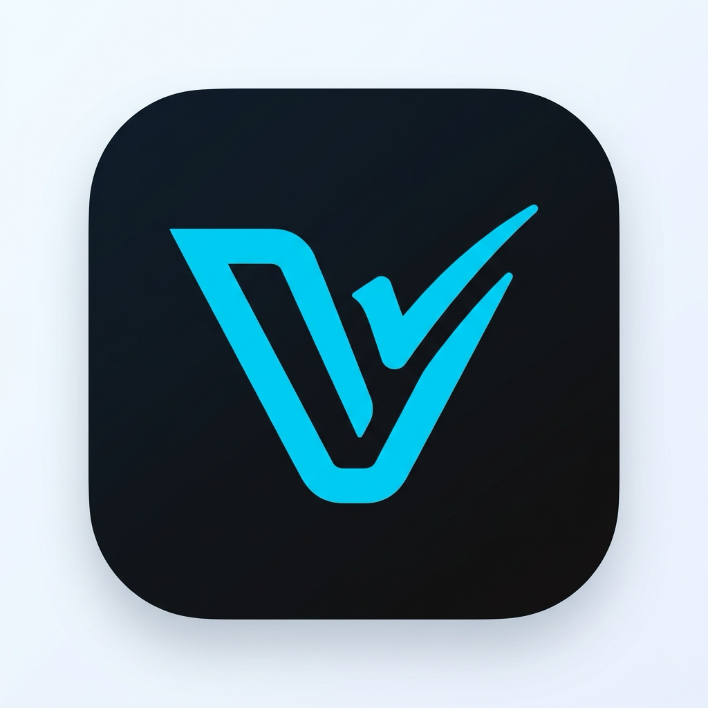

# Guanaco — Mobile Client for Vikunja

<p align="center">
  
</p>

<p align="center">
  <strong>Fast, private, offline-first mobile &amp; tablet task management for your self-hosted Vikunja server.</strong>
</p>

<p align="center">
  <a href="#-key-features">Features</a> •
  <a href="#-privacy--security">Privacy</a> •
  <a href="#-architecture--tech-stack">Architecture</a> •
  <a href="#-development--testing">Development</a> •
  <a href="PRIVACY_POLICY.md">Privacy Policy</a> •
  <a href="LICENSE">License</a>
</p>

---

## 🎯 Key Features

1. **0ms Optimistic UI, Offline-First Sync & Flexible Auth**:
   - Completing, creating, editing, reordering, and moving tasks happen instantaneously with 0ms UI latency.
   - Persistent offline mutation queue (`SyncQueue`) safely replays edits, resolves optimistic temporary IDs across restarts, and preserves unsynced user work across network drops or token expirations.
   - Sign in with **Username/Password + optional TOTP 2FA** (with automatic JWT renewal) or **Personal API Tokens (`tk_...`)** — with zero plaintext password storage.
   - Multi-page server pagination and active-window polling keep large Vikunja accounts synchronized without draining battery.

2. **Rapid Chained Task Entry (`QuickAddBar`)**:
   - Persistent bottom capture bar for rapid consecutive task entry, with live autocomplete and staple item suggestions.
   - Natural-language shortcut syntax (wrap entire input in `"quotes"` to bypass parsing):
     - `#tag` or `*tag` (and `#"multi word"` / `*"multi word"`) for labels
     - `!1`–`!5` or `!low`, `!medium`, `!high`, `!urgent`, `!critical` for priority
     - `+Project` or `+"Project Name"` for target list/project
     - `@user` for task assignment
     - `@today`, `@tomorrow`, `@tonight`, `today`, `tomorrow`, `tonight`, `in N days`, weekdays (`mon`–`sun` / `next monday`), `at 5pm` / `at 17:00` for due dates & times
     - `every [N] hour(s)/day(s)/week(s)/month(s)/year(s)` for recurring tasks

3. **Tactile Gestures & Haptics (`SwipeableTaskItem`)**:
   - **Swipe Left**: Instant completion / undo toggle (`✓ Done` / `Undo`) with tactile haptic feedback.
   - **Swipe Right**: Reveals **Move** (relocate task to another list) and **Delete** (protected by a 5-second **Undo** toast banner), alongside inline `+#` quick label controls.
   - **Reorder Mode**: Drag-and-drop (`☰`) or accessible `▲` / `▼` step reordering.

4. **Multi-Project Navigation, Smart Views & Tablet Split-View**:
   - Nested project hierarchy drawer with live open-task count badges, project sharing, and collapsible **Archived Lists** management.
   - Consolidated **All Tasks** and **My Open Tasks** views, smart on-device category/aisle grouping, and adaptive Light/Dark themes.
   - Dedicated sidebar split-view on tablets/foldables (`>= 768px`) and independent **Task Box Size** & **Task Text Size** scaling (`100%`–`200%`).

5. **Full Vikunja Task Details & Local Reminders**:
   - Descriptions/notes, percentage progress (`0%`–`100%`), start/due/end dates, flexible repeat modes (from due date, monthly, after completion), relative & absolute local reminders, labels, colors, and assignees.

---

## 🔒 Privacy & Security

Guanaco is built strictly for personal privacy and data sovereignty:
- **Direct Connection Only:** All traffic travels exclusively between your device and your configured Vikunja instance (HTTPS by default; explicit confirmation required for local cleartext HTTP).
- **Zero Telemetry & Zero Third-Party SDKs:** No Google Analytics, Firebase, Sentry, Crashlytics, or advertising identifiers.
- **Zero Plaintext Password Persistence:** Passwords and TOTP 2FA codes are used once to authenticate and immediately discarded. Only session JWTs or Personal API Tokens (`tk_...`) are stored in hardware-backed `expo-secure-store` (Android Keystore / iOS Keychain).
- **Cloud Auto-Backup Disabled (`android:allowBackup="false"`):** Local task caches are excluded from third-party cloud auto-backups.
- **100% Local Notifications & Resume-Aware Biometric Lock:** Task reminders run locally via `expo-notifications` without push relays or `SCHEDULE_EXACT_ALARM`. Optional fingerprint / Face ID lock protects app launch and background resume offline.

See the full [Privacy Policy](PRIVACY_POLICY.md).

---

## 🛠️ Architecture & Tech Stack

- **Framework**: React Native `0.86` & Expo `57` (TypeScript, New Architecture + Hermes)
- **State & Offline Sync**: Zustand + `@react-native-async-storage/async-storage`
- **Hardware Token Storage & Biometrics**: `expo-secure-store` + `expo-local-authentication`
- **Gestures & Animations**: `react-native-gesture-handler` + `react-native-reanimated` + `expo-haptics`
- **Native Android**: Tracked `android/` Gradle project (`armeabi-v7a`, `arm64-v8a`), R8 full-mode shrinking + mapping upload, and native Kotlin `InAppUpdateModule` (`com.google.android.play:app-update-ktx`)
- **Testing & CI**: Jest + `@testing-library/react-native`, verified across `UTC`, `America/Los_Angeles`, and `Asia/Tokyo` timezones in GitHub Actions

---

## 🧪 Development & Testing

```bash
# Install exact locked dependencies
npm ci

# TypeScript static type check
npm run typecheck

# Run full Jest test suite
npm test

# Verify timezone safety across UTC, US Pacific, and Tokyo offsets
TZ=UTC npm test
TZ=America/Los_Angeles npm test
TZ=Asia/Tokyo npm test

# Run tests with coverage report
npm run test:coverage

# Start Expo dev server / Web preview
npm start
npm run web
```

---

## 📦 Building & Publishing (Android)

Release builds never use hardcoded signing credentials. Provide your release keystore credentials via environment variables (or `~/.gradle/gradle.properties`):

```bash
export GUANACO_KEYSTORE_FILE="guanaco-release.keystore" # optional, defaults to android/app/guanaco-release.keystore
export GUANACO_KEYSTORE_PASSWORD="<your-keystore-password>"
export GUANACO_KEY_ALIAS="<your-key-alias>"
export GUANACO_KEY_PASSWORD="<your-key-password>"

# Bump semver + Android versionCode across package.json, app.json, version.ts, and build.gradle
npm run bump -- patch

# Build production Android App Bundle (.aab) with R8 optimization locally
npm run build:bundle

# Publish bundle + R8 mapping.txt to Google Play Console (requires play-service-account.json)
npm run publish:play -- --track internal
```

---

## 📄 License

Guanaco is free and open-source software licensed under the [GNU General Public License v3.0 (GPL-3.0-or-later)](LICENSE).  
Vikunja is an open-source project created by Kolaente.
