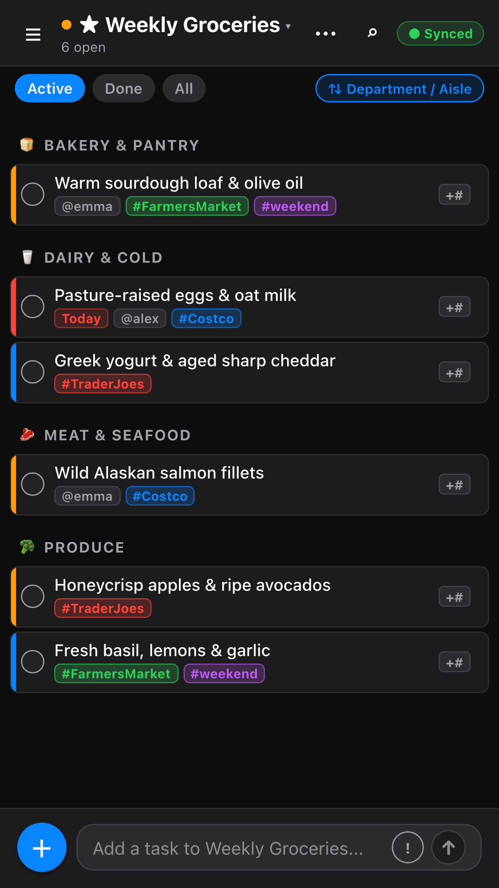
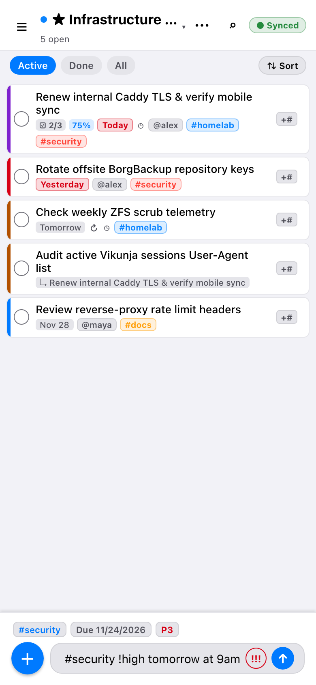
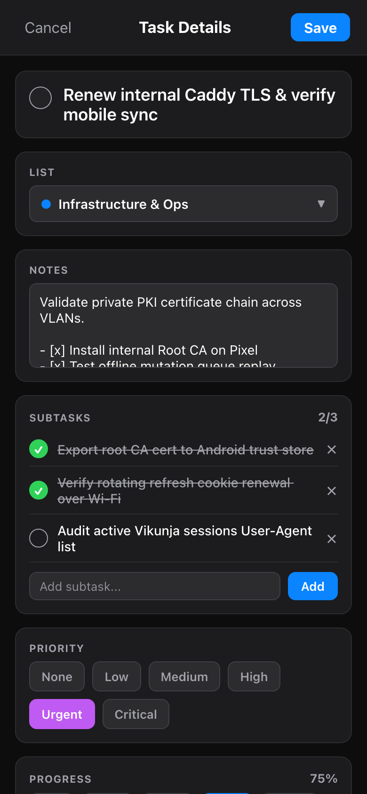

# Guanaco — Private Tasks, Lists & Reminders

<p align="center">
  
</p>

<p align="center">
  <strong>A fast, private to-do list, grocery, and task manager for Android, iOS, and tablets — use it 100% standalone offline or sync with <a href="https://vikunja.io/">Vikunja</a>.</strong>
</p>

<p align="center">
  <a href="https://github.com/TeraHz/guanaco/actions/workflows/ci.yml"></a>
  <a href="LICENSE"></a>
  
</p>

<p align="center">
  <a href="https://terahz.github.io/guanaco/">Website</a> •
  <a href="#screenshots">Screenshots</a> •
  <a href="#features">Features</a> •
  <a href="#quick-add-shortcuts">Quick-Add Shortcuts</a> •
  <a href="docs/USER_MANUAL.md"><strong>User Manual</strong></a> •
  <a href="#privacy">Privacy</a>
</p>

---

**Guanaco** is a fast, private task, grocery list, and project manager for Android, iPhone, iPad, and tablets. Use it **100% standalone on your device** with no server or account required, or connect directly to your self-hosted or cloud **[Vikunja](https://vikunja.io/)** server anytime — with zero ads, trackers, or third-party cloud intermediaries.

---

## Screenshots

<p align="center">
  
  
  
  
</p>

<details>
  <summary><strong>View Lists Drawer &amp; Tablet Split-Screen</strong></summary>
  <br />
  <p align="center">
    
    &nbsp;&nbsp;
    
  </p>
</details>

---

## Features

- **Standalone On-Device Mode & Seamless Vikunja Sync** — Tap **Use Offline on This Device** to start immediately with no server or account, export/import portable `.json` backups anytime, and optionally connect a Vikunja server later (uploading your local lists and tasks or starting fresh). When connected to a server, full offline caching queues changes in dead zones and syncs automatically once back online.
- **Tasks, Subtasks & Rich Notes** — Break larger tasks into subtasks with live progress counts, duplicate recurring templates, and read or edit formatted notes and checklists created in Vikunja Web.
- **Lists, Sublists & Saved Filters** — Organize nested lists, pin favorites, share lists with teammates, and open your Vikunja Saved Filters right from the sidebar.
- **Fast Search & Effortless Gestures** — Search across every list by title, note, label, or assignee. Swipe left to complete a task, swipe right to move or delete it, or drag items into your own custom order.
- **Flexible Schedules & Reminders** — Set due dates, postpone tasks by `+1d / +3d / +1w`, configure custom repeat intervals (every few hours, days, weeks, months, or years), and mark tasks complete or snooze them straight from a notification.
- **Comfortable on Every Screen** — Choose Light, Dark, or pure black OLED mode, adjust card size and text size separately, and enjoy a side-by-side layout on tablets and foldables.
- **Multilingual (English, Bulgarian & Spanish)** — Full UI, natural-language quick-add parsing, and on-device smart grocery/aisle grouping in **English**, **Български**, and **Español** (follows your system language or can be switched manually).
- **Home-Server Friendly** — Sign in with your password (including two-factor codes) or an API token, lock the app with Fingerprint or Face ID, and connect to private home servers using custom certificates on Android.

---

## Quick-Add Shortcuts

Type naturally in the bottom bar — shortcuts turn into tags, dates, and priorities automatically as you type (wrap a title in `"quotes"` if you want the exact text kept as-is):

| To Set | Type | Example |
| :--- | :--- | :--- |
| **Labels** | `#tag` or `#"two words"` | `Pay utility bill #home #bills` |
| **List** | `+List` or `+"List Name"` | `Oat milk +"Weekly Groceries"` |
| **Priority** | `!1`–`!5` or `!low` to `!critical` | `Renew passport !high` |
| **Due Date & Time** | `today`, `tomorrow`, `next fri`, `in 3 days`, `at 5pm` | `Call dentist tomorrow at 9:30am` |
| **Repeat** | `every [N] hours/days/weeks/months/years` | `Water plants every 4 days` |
| **Assignee** | `@username` | `Review trip itinerary @alex` |

For setup tips, saved filters, reminders, and troubleshooting, read the **[User Manual](docs/USER_MANUAL.md)**.

---

## Privacy

- **Direct connection only:** Your tasks travel straight between your device and your Vikunja server — never through third-party servers.
- **No tracking or ads:** Guanaco includes no analytics, crash-reporting trackers, advertising SDKs, or external push-notification services.
- **Protected credentials:** Your password is used once to sign in and is never saved on the device.

Read the full [Privacy Policy](PRIVACY_POLICY.md).

---

## Building from Source

<details>
  <summary>Developer setup &amp; test commands</summary>

```bash
# Install dependencies
npm ci

# Run type checks and test suite
npm run typecheck
npm test

# Start the development server
npm start

# Regenerate documentation screenshots
npm run screenshots
```

For signed Android Play Store bundles locally, supply `GUANACO_KEYSTORE_FILE`, `GUANACO_KEYSTORE_PASSWORD`, `GUANACO_KEY_ALIAS`, and `GUANACO_KEY_PASSWORD` in your environment and run `npm run build:bundle`.

Automated GitHub Release APK builds ([`.github/workflows/release.yml`](.github/workflows/release.yml)) run on `v*` tags once `GUANACO_KEYSTORE_BASE64`, `GUANACO_KEYSTORE_PASSWORD`, `GUANACO_KEY_ALIAS`, and `GUANACO_KEY_PASSWORD` are added to GitHub Actions repository secrets.
</details>

---

## License

Guanaco is free and open-source software licensed under the [GNU General Public License v3.0](LICENSE).  
[Vikunja](https://vikunja.io/) is an open-source project created by Kolaente.
