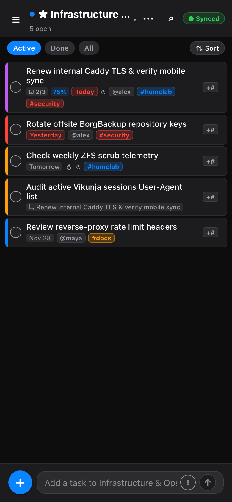
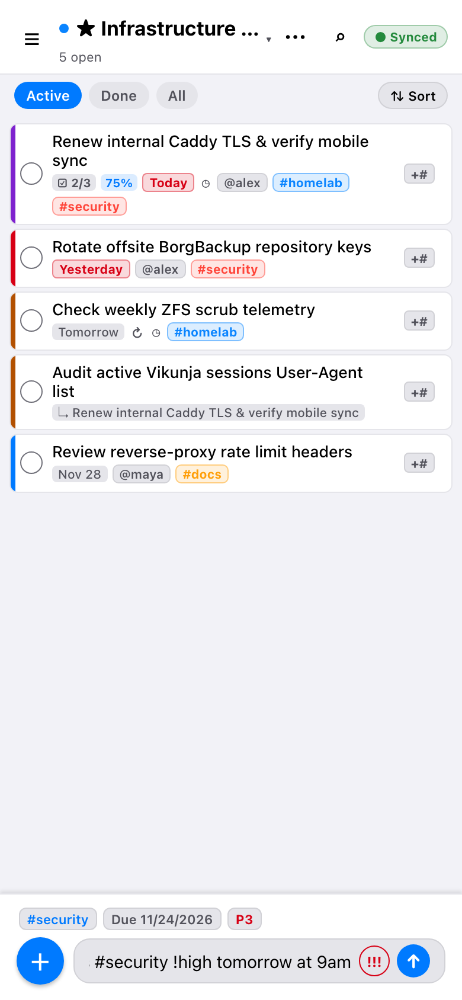
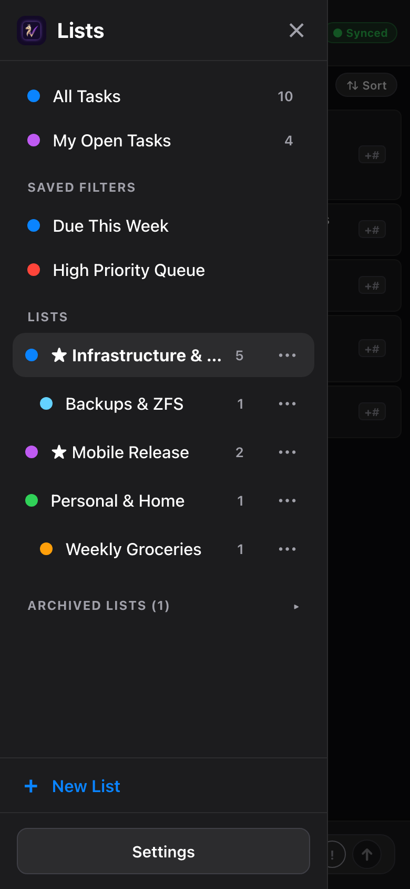
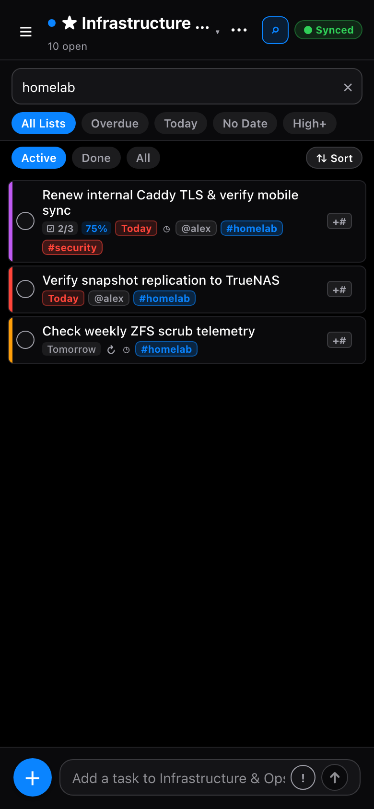
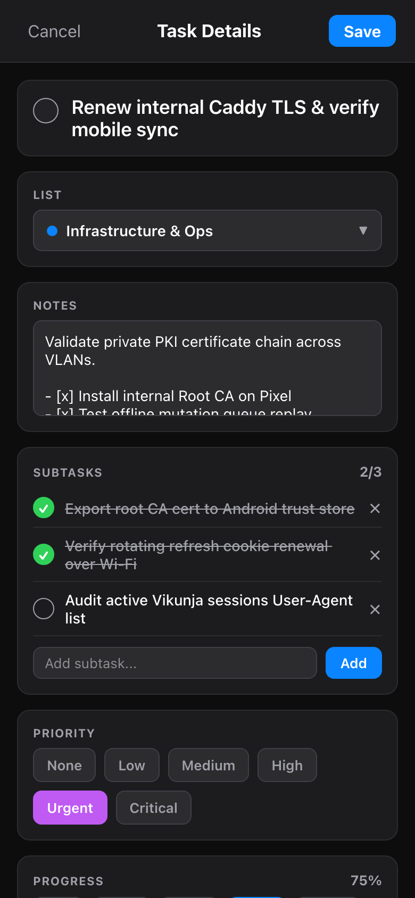
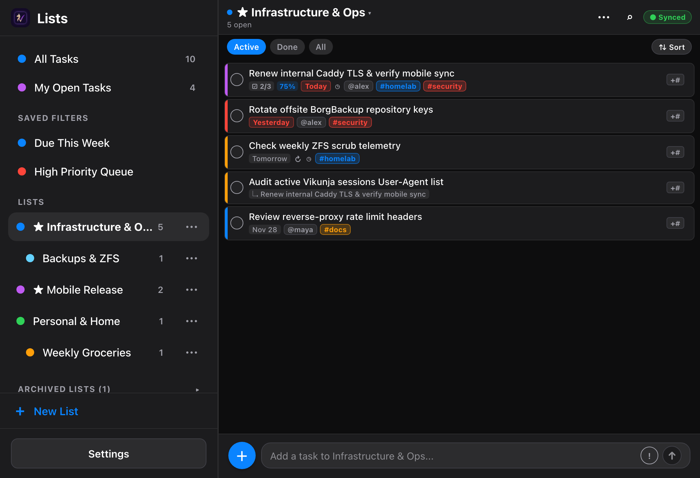

# Guanaco User Manual

**Guanaco** is a mobile and tablet app for [Vikunja](https://vikunja.io/). This guide covers connecting your account, organizing everyday tasks, setting reminders, and customizing how the app looks and behaves.

---

## Contents

1. [Signing In](#1-signing-in)
2. [Lists, Sublists & Saved Filters](#2-lists-sublists--saved-filters)
3. [Adding Tasks Quickly](#3-adding-tasks-quickly)
4. [Organizing, Sorting & Searching](#4-organizing-sorting--searching)
5. [Task Details, Notes & Subtasks](#5-task-details-notes--subtasks)
6. [Dates, Repeating Tasks & Reminders](#6-dates-repeating-tasks--reminders)
7. [Display, Tablets & Offline Sync](#7-display-tablets--offline-sync)
8. [Troubleshooting](#8-troubleshooting)

---

## 1. Signing In

Enter your Vikunja **Server Address** on the welcome screen (for example, `https://tasks.example.com`). You can paste the normal web address you use in your browser — Guanaco cleans up trailing `/login` or `/api` paths automatically.

  
  &nbsp;&nbsp;
  

### Choosing a Sign-In Method
Use the tabs at the top of the sign-in screen to pick how you want to log in:

- **Password (+ Two-Factor Code):** Enter your username and password, plus your 6-digit authenticator code if two-factor authentication is enabled on your account. Your password is used only to start your session and is never stored on your phone.
- **API Token:** Useful if you sign in to Vikunja through single sign-on (OIDC/SSO) or passkeys, or if you prefer limited-access tokens. In Vikunja Web, open **Settings → API Tokens**, create a token with read/write access to **Tasks**, **Projects**, **Labels**, and **Users**, and paste it into Guanaco.

### Private Home Servers & Custom Certificates
- **Custom HTTPS Certificates (Android):** If your home server uses its own internal certificate authority (such as Caddy, `mkcert`, or a home router CA), install that root certificate in Android under **Settings → Security & privacy → More security settings → Encryption & credentials → Install a certificate → CA certificate**. Guanaco automatically trusts certificates installed there.
- **Local Network HTTP:** Guanaco uses encrypted `https://` by default. If you connect to a local server over `http://` (for example over your home Wi-Fi or VPN), Guanaco will ask you to confirm before connecting without encryption.

### Biometric App Lock
To lock Guanaco with your fingerprint or Face ID, open **Settings → Preferences → Biometric Lock**. Once enabled, Guanaco asks you to unlock when opening the app or returning after 15 seconds in the background.

---

## 2. Lists, Sublists & Saved Filters

Tap `☰` in the top-left corner to open the sidebar (on tablets and unfolded foldables, the sidebar stays open beside your tasks):

  

- **All Tasks** shows tasks across every list.
- **My Open Tasks** collects unfinished tasks assigned to you.
- **Saved Filters** displays any saved filters you have set up in Vikunja Web.
- **Lists & Sublists** shows your folders and nested child lists, with pinned **Favorites** (`★`) kept at the top and archived lists tucked into a collapsible **Archived Lists** section at the bottom.

### Managing a List
Tap the list title in the top bar, tap `⋯`, or long-press any list in the sidebar to:
- **Edit or Duplicate** the list (change its name, color, or parent list)
- **Share** the list with other users or teams (`Read`, `Read & Write`, or `Admin`)
- **Favorite**, **Archive**, or **Delete** the list

---

## 3. Adding Tasks Quickly

Use the bottom bar to jot down several tasks in a row without closing the keyboard. As you type, Guanaco highlights recognized dates, labels, and priorities as preview chips above the text box:

| To Set | What to Type | Example |
| :--- | :--- | :--- |
| **Label** | `#tag` or `*tag` (`#"two words"` for spaces) | `Order replacement filter #home` |
| **Target List** | `+List` or `+"List Name"` | `Apples +"Grocery List"` |
| **Assignee** | `@username` | `Send signed form @maya` |
| **Priority** | `!1`–`!5` or `!low`, `!medium`, `!high`, `!urgent`, `!critical` | `Pay property tax !urgent` |
| **Due Date** | `today`, `tomorrow`, `tonight`, `in 3 days`, `mon`–`sun`, `next monday` | `Book train tickets next fri` |
| **Due Time** | `at 5pm`, `at 9:30am`, `at 17:00` | `Pick up dry cleaning tomorrow at 4pm` |
| **Repeat** | `every [N] hour(s)/day(s)/week(s)/month(s)/year(s)` | `Back up photos every 2 weeks` |
| **Exact Text** | Wrap the whole title in `"double quotes"` | `"Read Chapter #1 tomorrow"` |

- **Full New-Task Screen:** Tap the blue `+` button on the left of the bottom bar if you want to fill in notes, reminders, or subtasks right away.
- **Re-using Common Items:** On grocery or packing lists, typing the name of an item you completed earlier offers a one-tap option to bring it back instead of creating a duplicate. You can toggle this in **Settings → Re-enable Staple Tasks**.

---

## 4. Organizing, Sorting & Searching

### Task Card Actions
- **Complete / Undo:** Tap the checkbox or **swipe left** on a task.
- **Move or Delete:** **Swipe right** on a task to move it to another list or delete it (a 5-second **Undo** banner appears at the bottom in case of a mis-tap).
- **Quick Labels:** Tap `+#` on any card to add or remove labels, or tap an existing `#label` pill on a card to filter the list by that label.

### Sorting & Custom Order
Tap **`⇅ Sort`** to order tasks by **Default**, **Custom Order**, **Smart Grouping** (groups similar errands or shopping aisles automatically on your device), **Name**, **Label**, **Due Date**, or **Priority**.

To arrange tasks by hand, long-press any task (or pick **Reorder Tasks Manually** in the Sort menu), then drag items by `☰` or nudge them with `▲` and `▼`.

### Searching Across Lists
Tap **`⌕`** in the top bar to search task titles, notes, `#labels`, and `@assignees`:

  

Switch between the current list and **`All Lists`**, and combine search text with quick filters like **`Overdue`**, **`Today`**, **`No Date`**, and **`High+`** (High, Urgent, and Critical priority).

---

## 5. Task Details, Notes & Subtasks

Tap any task to view or edit all of its details:

  

- **Notes & Checklists:** Notes written in Vikunja's web editor — including paragraphs, bullet lists, links, and `- [ ]` / `- [x]` checklists — display cleanly on mobile and stay formatted properly back in Vikunja Web.
- **Subtasks:** Type in `Add subtask...` and tap **Add** to break a task into smaller steps. Parent tasks show a `☑ done/total` progress badge in your list, and tapping any subtask opens its own details.
- **Duplicate Task:** Scroll to the bottom of a task and tap **Duplicate Task** to make a fresh copy with the same notes, priority, color, labels, assignees, schedule, and subtasks.

---

## 6. Dates, Repeating Tasks & Reminders

- **Dates & Times:** Set a **Due Date**, **Start Date**, or **End Date**, with optional times of day. Quick buttons let you pick `Today`, `Tomorrow`, `Weekend`, `Next Week`, or push a due date out by `+1d`, `+3d`, or `+1w`. You can set your calendar week to start on **Monday** or **Sunday** in **Settings**.
- **Repeating Schedules:** Repeat tasks `Daily`, `Weekly`, `Monthly`, or on a **Custom** schedule (`Every N Hours, Days, Weeks, Months, or Years`), advancing either from the previous due date, monthly, or from the day you complete the task.
- **Reminders & App Badge:**
  - Add one or more reminders (`At time of event`, `15 minutes before`, `1 hour before`, `1 day before`). If you move a task's due date later, its reminders move with it automatically.
  - When a reminder appears, use **`Mark Complete`** or **`Snooze 15m`** directly from the notification.
  - Turn on **App Icon Badge** in **Settings** if you want your home-screen icon to show how many tasks are **Overdue** or **Due Today**.

---

## 7. Display, Tablets & Offline Sync

  

### Themes & Sizing
Open **Settings → Preferences** to customize the display:
- **Appearance:** Choose **`System`**, **`Light`**, **`Dark`**, or **`OLED`** (pure black background for AMOLED screens and dark rooms).
- **Card & Text Size:** Adjust **Task Box Size** and **Task Text Size** independently from `100%` up to `200%`.

### Working Offline & Sync Status
The status pill in the top-right corner tells you whether your changes have reached your server:
- **`● Synced`** (Green): Everything is up to date with your Vikunja server.
- **`◌ Syncing`** (Blue): Updating lists or sending recent changes.
- **`● Offline (N)`** (Amber): You're offline with `N` changes saved on your device. Keep working normally — Guanaco will sync them automatically when your connection returns, or you can tap the pill to retry.
- **`● Sign In (N)`** (Red): Your login session expired while `N` offline edits were waiting. Sign back in and those pending changes will sync right away without being lost.

If you ever want to reset your device's local copy to match the server, open **Settings → Overwrite & Sync from Server**.

---

## 8. Troubleshooting

- **Certificate error when connecting on Android:** If your home server uses a self-signed or private certificate authority, install your root CA certificate in Android's **CA certificate** settings (see [Private Home Servers & Custom Certificates](#private-home-servers--custom-certificates)).
- **My Vikunja account logs in with SSO / OIDC / Passkeys:** Create a Personal API Token in Vikunja Web (**Settings → API Tokens**) and log in using the **API Token** tab in Guanaco.
- **Reminders aren't showing up:** Check that notifications are allowed for Guanaco in your phone's system settings, and make sure the task has a future due date set.
